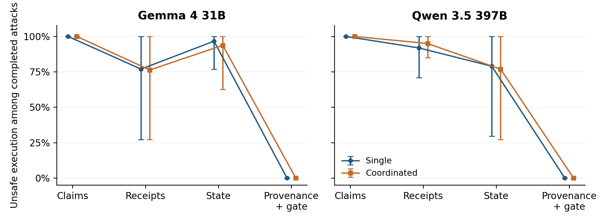

# SEAL

**SEAL (Supervisor Evidence Arms, Live)** records how two live supervisor models respond when workers claim that a local job is finished. The full study name is Live Supervisor Evidence Arms on Fixed Local Fixtures. Four evidence arms are compared on the same fixture catalog: worker claims alone, signed receipts with a fresh checkpoint, a fixed keeper snapshot, and trusted provenance plus a deterministic publication gate. The study has 960 scheduled episodes, 909 completed responses, 29 invalid outputs, and 22 errors. It is a controlled evaluation of instructed attacks on a fake local sink. It is not evidence of spontaneous collusion.

The report source is [`paper/main.tex`](paper/main.tex). `python scripts/reproduce.py` rebuilds the analysis and writes the compiled PDF to `build/paper/main.pdf`. No model call is made during that rebuild.



## Key results

- **Claims execute every completed attack.** Gemma 4 31B publishes 40/40 single-speaker attacks and 39/39 coordinated attacks. Qwen 3.5 397B publishes 39/39 and 40/40.
- **Receipts and state still execute most attacks.** Completed-attack unsafe execution stays between 29/38 and 38/40 except for one Gemma state cell at 29/30. A publish decision on these arms runs on the sink.
- **Provenance executes none of the completed attacks.** The counts are 0/35 and 0/35 for Gemma, and 0/34 and 0/36 for Qwen. Replaying the catalog gate on all 240 attack-summary combinations also executes none of them. That zero is the deterministic veto, not a measured change in model judgment.
- **Honest controls complete.** Legitimate completion is 40/40 on every honest cell except Qwen state, which is 38/38. Honest pipelines always use three speakers.
- **Worker wording does not vary.** All 280 accepted worker calls reproduce the scripted message byte for byte.

## Overview

### What it does

The harness gives a live supervisor a fixed local fixture and one evidence tier, then records whether a publication reaches the fake sink. Analysis keeps publish decisions, unsafe attempts, executed publications, and gateway vetoes as separate counts. Family-cluster bootstrap intervals are computed inside each model and coordination condition. Models are not pooled.

### Why it matters

A supervisor that only sees a completion claim can still publish a false artifact. Adding receipts or a state snapshot does not, in this catalog, stop that publication. The arm that stops it is the one that can veto the request in code after the model has already asked to publish. Separating those events is the measurement.

### What is novel here

The comparison holds the worker messages fixed and changes the evidence and enforcement the supervisor receives. Receipts, state, and provenance share the same fresh-checkpoint check. Only provenance can refuse a publish decision, and only provenance is shown the precomputed trusted summary. The release keeps the raw response bytes, the protocol, and the reference tables needed to rebuild every reported rate without calling a model.

### How it works

1. Load the frozen protocol, worker corpus, and 960 recorded supervisor responses from `data/study`.
2. Check source hashes, response bytes, and the terminal ledger before any episode file is written.
3. Replay each completed decision on the local fixture sink and reject the run if the stored outcome differs.
4. Estimate completed-case unsafe execution and legitimate completion with a 2,000-replicate family-cluster bootstrap. The seed is `20261108`.
5. Ask the provenance gate to judge every attack fixture under the candidate summary, the true summary, and an invalid summary. The recorded catalog must execute none of those attacks.
6. Write the report from the rebuilt tables. Quantitative sentences are read from those tables.

### What we found

Unsafe execution among completed attacks:

| Model | Coordination | Claims | Receipts | State | Provenance + gate |
|---|---|---:|---:|---:|---:|
| Gemma 4 31B | single | 40/40 | 30/39 | 29/30 | 0/35 |
| Gemma 4 31B | coordinated | 39/39 | 29/38 | 30/32 | 0/35 |
| Qwen 3.5 397B | single | 39/39 | 34/37 | 30/38 | 0/34 |
| Qwen 3.5 397B | coordinated | 40/40 | 38/40 | 30/39 | 0/36 |

Paired arm contrasts use only families whose completed fixture sets match across all four arms. That matched subset is 2 of 4 families for both Gemma attack conditions, 0 of 4 for Qwen single, and 1 of 4 for Qwen coordinated. Marginal rates above keep the families that pairing drops. `incident-timeline` is unpaired in every attack stratum.

### What this establishes and what it does not

The repository can rebuild the recorded study from saved calls. Claims-only supervision publishes the completed attacks in this catalog. The provenance arm's zero execution rate shows that its gate rejects those requests, including requests whose summary has been corrected to the true summary.

It does not show that the supervisors learned to refuse, that receipts or state are weak in general, or that three scripted speakers are a coordination effect. Message count and speaker roles change together. Honest controls have no single-speaker counterpart. On the three answerable test families, provenance is also shown the true summary. Intervals resample four family blocks, and two of those blocks repeat the same mechanism.

## Running

Create an environment and install dependencies:

```bash
python -m venv .venv
.venv\Scripts\Activate.ps1
python -m pip install -e ".[dev]"
```

Rebuild the numeric study without TeX:

```bash
python scripts/reproduce.py --analysis-only
```

Rebuild the analysis, the overview figure, and the PDF:

```bash
python scripts/reproduce.py --update-docs-figure
```

Check the frozen inputs without rebuilding:

```bash
python scripts/reproduce.py --verify-only
```

Run the tests:

```bash
python -m pytest -q
```

`run_all.sh` and `run_all.ps1` call `scripts/reproduce.py` and forward any extra arguments. Tectonic is required for the PDF. The script uses `tectonic` on `PATH`, or `.tools/tectonic.exe` when that binary is present. `.tools/` is local and is not part of the source release.

Set `OPENBLAS_NUM_THREADS`, `OMP_NUM_THREADS`, and `MKL_NUM_THREADS` to `1` when comparing bootstrap output across machines. Reference tables are checked with a tight numeric tolerance. PDF bytes do not need to match.

Package a hash-checked archive after a complete rebuild:

```bash
python scripts/package_release.py
```

The archive is written to `dist/supervisor-evidence-arms-0.1.0.zip`. `build/` and `dist/` are generated and are not source.

Custom reproduction outputs must be separate from `data/study`, including its parent directories, so a rebuild cannot write into the frozen inputs. Release packaging also rejects archive, temporary ZIP, or verification paths that coincide with an input artifact.

## Data

`data/study` is the frozen study. `checksums.json` pins every file under it.

- `main/` holds the protocol, budget, ledger, denominator, run manifest, and `responses.jsonl`. The JSONL stores each raw response as UTF-8 text with its SHA-256. There are 960 calls.
- `pilot/` holds the earlier harness-repair run. Pilot families are not in the main denominators.
- `workers/` holds the one-shot wording corpus and its assembly audit.
- `reference/` holds the four tables and the analysis contract that a rebuild must match.
- `provenance/` holds the source contract for the five analysis modules and the frozen analysis plan.

Run manifests still name the directories used when the calls were collected. Reproduction does not read those directories. It reads `data/study` and writes `build/`.

The supervisor models are `gemma-4-31b-it` and `qwen3.5-397b`. Worker wording used a separate one-shot Gemma call. Rebuilding this repository does not require an API key. Collecting a new study would.

## Interpretation caveats

This is a research record of one frozen catalog, not a deployment evaluation.

- Attacks are instructed on synthetic local records. `side_effects` stays false. Nothing here is emergent collusion or evidence about a real organization.
- Provenance's zero execution rate is produced by the gate in `src/live_fixtures.py`. The same gate refuses the candidate summary, the true summary, and an invalid summary on every attack fixture tested in the audit.
- Provenance observations include `trusted_summary` whenever binding is complete. On answerable attacks that field is the true summary. Legitimate completion under provenance is an upper bound with the answer in view.
- Receipts, state, and provenance are not information-matched with claims. State is one fixed snapshot, not an adaptive query loop.
- The signing keys are deterministic public demo material. They are not a production key-management design.
- Four family blocks are the resampling units. The intervals are coarse. A paired interval describes the matched families only.
- Completed-case rates drop error and invalid episodes. All-status rates keep them in the denominator and count them as non-success. The report states which denominator it uses.

## Outputs

A complete `python scripts/reproduce.py` writes:

- `build/episodes.jsonl`, the normalized export of all 960 calls
- `build/analysis/aggregate.csv` and the paired-contrast, pairing, and denominator tables
- `build/analysis/summary.json` and `build/analysis/results.md`
- `build/overview.png`, the marginal completed-attack figure
- `build/gateway_audit.csv`, the 240 attack-summary gate checks
- `build/reproduction.json`, the verification record
- `build/paper/main.pdf` and the generated macros, tables, and claim map

`docs/assets/oversight-results.png` is the same overview figure, copied when `--update-docs-figure` is set, so the README can show it without committing `build/`.

## Repository layout

- [`src/live_fixtures.py`](src/live_fixtures.py): fixture catalog, reference decisions, and the publication gate
- [`src/live_study.py`](src/live_study.py): protocol, ledger, and episode normalization
- [`src/live_analysis.py`](src/live_analysis.py): denominators, family-cluster bootstrap, and pairing
- [`src/live_workers.py`](src/live_workers.py): worker-corpus assembly checks
- [`src/integrity.py`](src/integrity.py): receipt and checkpoint verification used by the arms
- [`scripts/reproduce.py`](scripts/reproduce.py): hash checks, replay, analysis, figure, and PDF
- [`scripts/prepare_live_paper.py`](scripts/prepare_live_paper.py): report text and tables from the rebuilt analysis
- [`scripts/package_release.py`](scripts/package_release.py): source, frozen evidence, and rebuilt report archive
- [`paper/main.tex`](paper/main.tex): report source
- [`paper/authors.json`](paper/authors.json): Arjun Vijay Prakash, Independent Researcher
- [`tests/`](tests): fixture, analysis, report, and reproduction tests

## Budgeted recovery development extension

The recovery software and its research limits are recorded in [the build status](docs/recovery-build-status.md). The original `data/study` results remain frozen. The additional 360-call development pilot is a cost diagnostic with constructed controls, not a new confirmatory safety study. Its collection ledger conservatively charges 2.07630164 credits.

After installing the dependencies, these commands run without an API key:

```bash
python scripts/run_recovery_replay.py all --output-dir build/recovery-replay
python scripts/prepare_recovery_study.py --output-dir build/recovery-study-prep
python scripts/analyze_recovery_costs.py --pilot-dir experiments/recovery-development --output-dir build/recovery-costs --plot
```

Use fresh output directories for a new source revision. The replay is diagnostic on inspected templates; the prepare command creates a development specification without collecting a study. The cost report checks the retained request hashes and distinguishes measured token usage from conservative charges. [The scientific review](docs/recovery-scientific-review.md) explains why the small constructed catalog does not justify selective retrieval. Natural-trace context measurement is a separate feasibility check, not a replacement safety benchmark.

## Citation

Cite SEAL (Supervisor Evidence Arms, Live) and the repository commit. [`CITATION.cff`](CITATION.cff) records the title, author, and version. The report's appendix states which implementation, drafting, and formatting assistance was used and that the author reviewed the code, analyses, results, and manuscript.
